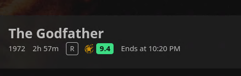

# Critic AVG for Jellyfin

*Dozens of critics. One clear score.*

This plugin shows the **Critic AVG** score on the film page in Jellyfin. You can also sort your film library by this score.

Critic AVG is one weighted average of IMDb, TMDB, Trakt, Letterboxd, MUBI, Rotten Tomatoes, Metacritic and SensaCine.

**Website:** [criticavg.serranof.workers.dev](https://criticavg.serranof.workers.dev)



---

## Contents

1. [What the plugin does](#1--what-the-plugin-does)
2. [Before you start](#2--before-you-start)
3. [Build the plugin on GitHub](#3--build-the-plugin-on-github)
4. [Install the plugin in Jellyfin](#4--install-the-plugin-in-jellyfin)
5. [Set the plugin](#5--set-the-plugin)
6. [Get the scores](#6--get-the-scores)
7. [Sort the library by Critic AVG](#7--sort-the-library-by-critic-avg)
8. [Update the plugin](#8--update-the-plugin)
9. [Troubleshooting](#9--troubleshooting)
10. [Files](#10--files)

---

## 1 · What the plugin does

- The plugin adds a badge to the film page. The badge shows the Critic AVG logo and the score.
- The badge color shows the score: green is 7 or more, yellow is 5 to 6.9, red is less than 5.
- The plugin writes the score into a Jellyfin rating field. Jellyfin uses this field to sort the library.
- The plugin gets new scores every night at 04:00.
- The plugin gets the score of each film again after 7 days.
- The plugin gets a maximum of 300 films each night. Thus, a library of 1,500 films is complete after 5 nights.

**Where you can see the badge**

| Jellyfin app | Badge |
|---|---|
| Web browser | Yes |
| Android phone app | Yes |
| Jellyfin Media Player (desktop) | Yes |
| Android TV, Swiftfin, Roku and other TV apps | No. These apps show the score in the rating field (the tomato or the star). |

**Jellyfin versions**

| Jellyfin | Plugin build |
|---|---|
| 12.x (for example 12.4) | `x.x.x.12` |
| 10.11.x | `x.x.x.11` |

Jellyfin selects the correct build automatically.

---

## 2 · Before you start

You need these items:

- A Jellyfin server, version 12.x or 10.11.x.
- Administrator access to the Jellyfin dashboard.
- A Critic AVG server (Cloudflare worker), version 2026-11-10.1 or newer.
- A GitHub account.

**Make sure that the Critic AVG server is correct:**

1. Open this address in a web browser:

   ```
   https://criticavg.serranof.workers.dev/api/score?tmdb=693134
   ```

2. Make sure that you see `"original_title":"Dune: Part Two"` and a `"score"` value.

> **CAUTION:** Do not add `#` or other text to the server address. The text after `#` stays in the browser and does not go to the server.

---

## 3 · Build the plugin on GitHub

GitHub builds the plugin. You do not need .NET on your computer.

1. On GitHub, open the repository `criticavg_Jellyfin_Addon`.
2. Click the **Actions** tab.
3. Click **Build and publish Critic AVG for Jellyfin**.
4. Click **Run workflow**, then click the green **Run workflow** button.
5. Wait approximately 3 minutes.
6. Make sure that the 3 jobs have a green tick:
   - **Build for Jellyfin 12.0.0**
   - **Build for Jellyfin 10.11.11**
   - **Publish release and repository manifest**

> **NOTE:** If a job has a red cross, click the job. Copy the error text. Send the error text to the developer.

The workflow publishes the plugin to this repository address (the "manifest"):

```
https://raw.githubusercontent.com/FSerranos/criticavg_Jellyfin_Addon/manifest/manifest.json
```

> **NOTE:** GitHub can need up to 5 minutes to show a new manifest.

---

## 4 · Install the plugin in Jellyfin

### 4.1 Add the repository

1. In Jellyfin, click **☰** (top left), then click **Dashboard**.
2. Click **Plugins**.
3. Click **Manage Repositories**.
4. Click **+**.
5. Type these values:
   - **Name:** `Critic AVG`
   - **URL:** `https://raw.githubusercontent.com/FSerranos/criticavg_Jellyfin_Addon/manifest/manifest.json`
6. Click **Save**.
7. Accept the message about third-party repositories.

### 4.2 Install the plugin

1. Go back to **Plugins**.
2. In the search field, type `critic`.
3. Click **Critic AVG**.
4. In the version list, select the newest version.
5. Click **Install**.
6. Restart Jellyfin.
7. Go to **Dashboard → Plugins**. Click the **Installed** filter.
8. Make sure that **Critic AVG** shows the new version and the status **Active**.

> **NOTE:** Jellyfin does not have an "Update" button. To update, install the newer version.

> **NOTE:** Jellyfin cannot install a plugin from a zip file in the dashboard. For a manual installation, see [9.6](#96-manual-installation-without-the-repository).

---

## 5 · Set the plugin

1. Go to **Dashboard → Plugins**.
2. Click **Critic AVG**.
3. Set these fields:

| Field | Value | Function |
|---|---|---|
| **Critic AVG server address** | `https://criticavg.serranof.workers.dev` | The address of your Critic AVG server. Do not add `#`, a path or a `/` at the end. |
| **Weights · how the score is calculated** | **Balanced** (recommended) | The weight of each source in the average. These are the same presets as the Critic AVG website. |
| **How to show the score** | **Beside** or **Alone** | **Beside:** the badge is next to the star and the tomato. The star and the tomato show their initial values. **Alone:** the page shows only the badge. |
| **Jellyfin field that stores Critic AVG, for sorting** | **Critics Rating field** (recommended) | Jellyfin can sort only by its own fields. The plugin writes the score into this field. |
| **Fetch a film's score again after (days)** | `7` | The number of days before the plugin gets a new score. |
| **Most films to fetch per run** | `300` | The maximum number of films for each run. This value keeps the server in the free daily limit. |

4. Click **Test connection**.
5. Make sure that you see `Connected to Critic AVG` and a version number.
6. Click **Save**.

> **CAUTION:** **Test connection** does not save the settings. Click **Save** after the test.

---

## 6 · Get the scores

The plugin gets the scores every night at 04:00. To get the scores now, do these steps:

1. Go to **Dashboard**.
2. In the left menu, find the **Advanced** section.
3. Click **Scheduled Tasks**.
4. Find the **Critic AVG** group.
5. Click **▶** next to **Update Critic AVG scores**.
6. Wait until the progress bar shows 100%.
7. Open a film page.
8. Push **Ctrl+F5** to reload the page.
9. Make sure that you see the Critic AVG badge.

> **NOTE:** A film without a score does not show a badge. If the library has more than 300 films, some films get a score on the subsequent nights.

---

## 7 · Sort the library by Critic AVG

1. Open your film library.
2. Click the **sort** icon (**A→Z**).
3. Click **Critics Rating**.

> **NOTE:** If you selected **Community Rating field** in step 5, click **Community Rating**.

---

## 8 · Update the plugin

Do these steps for each new version:

1. On GitHub, open the file `.github/workflows/publish.yml`.
2. Click the pencil icon to edit the file.
3. Find the line `PLUGIN_VERSION: "1.1.0"`.
4. Increase the number. For example, change `"1.1.0"` to `"1.2.0"`.
5. Click **Commit changes**.
6. Do the steps in [section 3](#3--build-the-plugin-on-github).
7. Wait 5 minutes.
8. Do the steps in [section 4.2](#42-install-the-plugin).

> **CAUTION:** Always increase `PLUGIN_VERSION`. If the number does not change, Jellyfin does not see the new version.

> **CAUTION:** Edit only the file in the `.github/workflows` folder. GitHub does not use a `publish.yml` file in other folders.

---

## 9 · Troubleshooting

### 9.1 Jellyfin does not show the new version

1. Make sure that the 3 jobs in GitHub **Actions** have a green tick.
2. Make sure that you increased `PLUGIN_VERSION` in `.github/workflows/publish.yml`.
3. Wait 5 minutes.
4. In Jellyfin, click **Manage Repositories**.
5. Remove the **Critic AVG** repository.
6. Add the repository again (see [4.1](#41-add-the-repository)).
7. Push **Ctrl+F5**.

### 9.2 The search for "critic" shows no result

The Critic AVG repository is not in Jellyfin. Do the steps in [4.1](#41-add-the-repository).

### 9.3 The film page does not show the badge

Do this test on the film page:

1. Open a film page in Jellyfin.
2. Push **F12** (or **Ctrl+Shift+J** in Chrome).
3. Click the **Console** tab.
4. Click the last line of the console.
5. If the browser does not let you paste, type `allow pasting` and push **Enter**.
6. Paste this code and push **Enter**:

   ```js
   (async () => {
     const id = (location.hash.match(/id=([0-9a-f-]+)/i) || [])[1];
     const s = await fetch(ApiClient.getUrl('CriticAvg/ClientScript')).then(r => r.status).catch(e => 'error ' + e);
     console.log('1 · plugin script:', s);
     console.log('2 · injected:', !!document.querySelector('script[src*="CriticAvg"]'));
     console.log('3 · running:', !!window.__criticAvgLoaded);
     try { console.log('4 · score:', JSON.stringify(await ApiClient.ajax({ type: 'GET', url: ApiClient.getUrl('CriticAvg/Items/' + id), dataType: 'json' }))); }
     catch (e) { console.log('4 · score: ERROR', e && (e.status || e.message || e)); }
   })();
   ```

7. Read the 4 lines. Use this table:

| Line | Result | Cause | Action |
|---|---|---|---|
| 1 | Not `200` | The plugin is not active. | Do [4.2](#42-install-the-plugin). Restart Jellyfin. |
| 2 | `false` | The plugin cannot add its script to the web page. | Send the result to the developer. |
| 3 | `false` | The browser has an old copy of the page. | Push **Ctrl+F5**. |
| 4 | `ERROR 404` | The film does not have a score yet. | Do [section 6](#6--get-the-scores). |
| 4 | A score | All is correct. | Push **Ctrl+F5**. |

### 9.4 The score task gets no scores

1. Go to **Dashboard → Logs**.
2. Open the newest log file.
3. Push **Ctrl+F** and search for `Critic AVG:`.
4. Read the lines:
   - `no server address set`: do [section 5](#5--set-the-plugin).
   - `could not fetch`: make sure that the Critic AVG server is correct (see [section 2](#2--before-you-start)).
   - `X films checked, Y scores fetched`: the task is correct.

### 9.5 "Page not found" or "Server not found" in the browser

- **Server not found:** the address is not correct. Replace `IP` or `YOUR-SERVER` with the real address of your Jellyfin server. Copy the address from the browser tab with Jellyfin. Use only the part before `/web`.
- **Page not found** (Jellyfin page): the address has `/web/#/` before the plugin path. Remove `/web/#/`.

Correct example:

```
http://192.168.1.50:8096/CriticAvg/ClientScript
```

### 9.6 Manual installation without the repository

1. On GitHub, open **Releases**.
2. Download the zip for your Jellyfin version: `criticavg_x.x.x.12.zip` for Jellyfin 12, `criticavg_x.x.x.11.zip` for Jellyfin 10.11.
3. Extract the zip. You get 2 files: `Jellyfin.Plugin.CriticAvg.dll` and `meta.json`.

> **NOTE:** A zip from the GitHub **Actions** page contains a second zip. Extract the second zip also.

4. Stop Jellyfin.
5. Find the Jellyfin `plugins` folder:

| Installation | Folder |
|---|---|
| Windows | `C:\ProgramData\Jellyfin\Server\plugins` |
| Linux | `/var/lib/jellyfin/plugins` |
| Docker | `/config/plugins` |
| macOS | `~/.local/share/jellyfin/plugins` |

6. Remove the folder of the old Critic AVG version, if it is there.
7. Make a new folder with the name `Critic AVG_x.x.x.12` (use your version number).
8. Put the 2 files in the new folder.
9. Start Jellyfin.

### 9.7 The star or the tomato is not on the film page (Beside mode)

The plugin does not know the initial value of the field. This occurs with films that version 1.0 scored.

1. Open the film library.
2. Click **⋯** → **Refresh metadata**.
3. Select **Replace all metadata**.
4. Click **Refresh**.
5. Do [section 6](#6--get-the-scores).

### 9.8 Remove the plugin

1. Go to **Dashboard → Plugins**.
2. Click **Critic AVG** → **Uninstall**.
3. Restart Jellyfin.
4. Refresh the metadata of the film library (see [9.7](#97-the-star-or-the-tomato-is-not-on-the-film-page-beside-mode)). This step puts the initial ratings back.

---

## 10 · Files

| File | Function |
|---|---|
| `Jellyfin.Plugin.CriticAvg/Plugin.cs` | The plugin and its settings page |
| `Jellyfin.Plugin.CriticAvg/UpdateScoresTask.cs` | The nightly task. It gets the scores and writes the sort field. |
| `Jellyfin.Plugin.CriticAvg/CriticAvgClient.cs` | Connects to the Critic AVG server (`/api/score`) |
| `Jellyfin.Plugin.CriticAvg/ScoreStore.cs` | Keeps the scores and the initial ratings (`scores.json`) |
| `Jellyfin.Plugin.CriticAvg/Api/CriticAvgController.cs` | Plugin web API for the badge |
| `Jellyfin.Plugin.CriticAvg/Web/ClientScriptInjector.cs` | Adds the badge script to the Jellyfin web page (in memory, no file changes) |
| `Jellyfin.Plugin.CriticAvg/Web/criticavg.js` | The badge script (logo and score) |
| `Jellyfin.Plugin.CriticAvg/Configuration/configPage.html` | The settings page |
| `.github/workflows/publish.yml` | Builds the plugin for Jellyfin 12 and 10.11. Publishes the release and the manifest. |
| `scripts/package.py`, `scripts/make_manifest.py` | Make the plugin zips and the manifest |
| `assets/` | Logo and screenshot |

**Plugin ID:** `96c4c7d6-624e-40a0-86af-108a3c395608`

> **CAUTION:** Do not change the plugin ID. If you change it, Jellyfin sees a different plugin.
